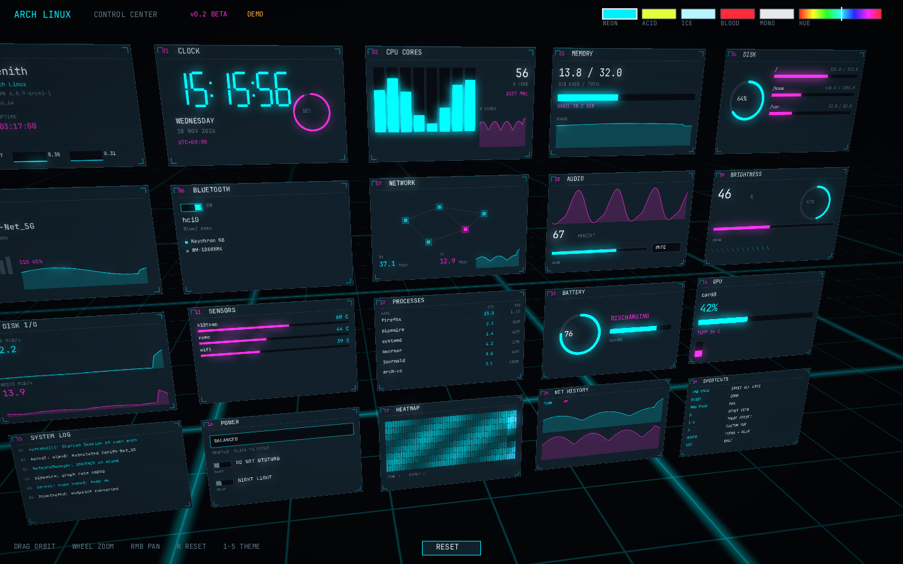
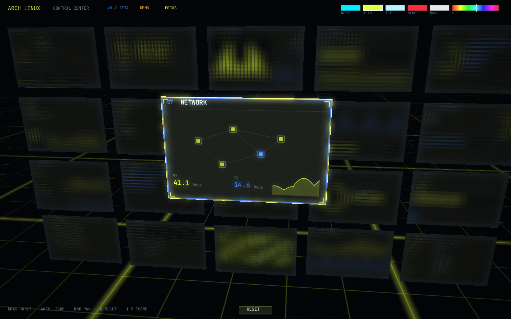

# Arch Control Center

Бета трёхмерного центра управления для Arch Linux: плотная панель из нумерованных плиток, которую можно свободно крутить в пространстве. Наведение выдвигает плитку к камере и размывает остальные. Неон, тонкая линейная графика, живые графики.






Стек: Rust, **wgpu** и **winit**. Настоящая 3D-сцена, орбитальная камера, постобработка (bloom) и размытие фона в шейдере плитки. Bevy 0.20 требует Rust 1.97 и очень долгую сборку; wgpu даёт тот же класс картинки (вращение по всем осям, зум, hover, blur) и собирается предсказуемо.

## Зависимости

Сборка на Arch:

```bash
sudo pacman -S --needed base-devel rustup pkgconf mesa libxkbcommon wayland alsa-lib
# libxkbcommon на Arch уже содержит libxkbcommon-x11.
# На Debian/Ubuntu отдельно: libxkbcommon-x11-0 libxkbcommon-dev
```

Для аппаратного Vulkan — драйвер видеокарты, для виртуалки без GPU — программный растеризатор:

```bash
sudo pacman -S vulkan-radeon   # AMD
sudo pacman -S vulkan-intel    # Intel
sudo pacman -S vulkan-swrast   # lavapipe, VM / без /dev/dri
```

Необязательные сервисы. Без них плитка показывает `UNAVAILABLE`, приложение не падает:

```bash
sudo pacman -S networkmanager bluez bluez-utils pipewire wireplumber \
  brightnessctl power-profiles-daemon
```

Громкость: `wpctl` (WirePlumber) или `pactl`. Яркость: sysfs `/sys/class/backlight` или `brightnessctl`. «Не беспокоить»: `dunstctl` или `makoctl`. Ночной свет: `gammastep` или `redshift`.

На Debian/Ubuntu для проверки в VM:

```bash
sudo apt install mesa-vulkan-drivers vulkan-tools libxkbcommon-dev pkg-config
```

Если Vulkan не находится, перед запуском:

```bash
export VK_ICD_FILENAMES=/usr/share/vulkan/icd.d/lvp_icd.json
```

Приложение само переключается на lavapipe, если нет `/dev/dri/card0`.

## Сборка и запуск

```bash
cargo build --release
./target/release/arch-control-center --demo
./target/release/arch-control-center            # живые CPU/RAM/диски/сеть
./target/release/arch-control-center --demo --showcase
./target/release/arch-control-center --demo --shots /tmp/acc-shots
```

`--demo` не трогает систему: тумблеры меняют только симуляцию. `--showcase` включает демо, медленно вращает сцену, фокусирует плитку NETWORK и переключает тему. `--shots` сохраняет три PNG и выходит.

Нужен графический сеанс (X11 или Wayland).

Оверлей поверх рабочего стола (без рамки, на весь экран, фон полупрозрачный, чтобы композитор мог его размыть):

```bash
arch-control-center --overlay
# или в конфиге: overlay = true
```

Повторный запуск с `--overlay` (или с `overlay = true`) закрывает уже открытую панель. `Esc` тоже закрывает, с плавным затуханием. Wayland `app_id` и класс X11 окна — `arch-control-center`.

## Hyprland

Готовый фрагмент для `~/.config/hypr/hyprland.conf`. `SUPER+D` открывает панель и тем же нажатием закрывает её.

```
bind = SUPER, D, exec, arch-control-center --demo --overlay
# уберите --demo, когда нужны живые датчики:
# bind = SUPER, D, exec, arch-control-center --overlay

windowrulev2 = float, class:^(arch-control-center)$
windowrulev2 = fullscreen, class:^(arch-control-center)$
windowrulev2 = noborder, class:^(arch-control-center)$
windowrulev2 = noshadow, class:^(arch-control-center)$
windowrulev2 = noanim, class:^(arch-control-center)$
windowrulev2 = pin, class:^(arch-control-center)$
```

`noanim` отключает анимацию самого Hyprland: появление и уход рисует приложение. Окно — обычный toplevel (winit), не слой `zwlr_layer_shell`, поэтому `layerrule` на него не вешается. Размытие рабочего стола за полупрозрачным окном включает общий blur:

```
decoration {
    blur {
        enabled = true
        size = 8
        passes = 2
        xray = false
    }
}
```

Если панель когда-нибудь окажется в layer-shell с этим именем, правило такое:

```
layerrule = blur, ^(arch-control-center)$
```

## Управление

| Ввод | Действие |
| --- | --- |
| Перетаскивание ЛКМ | Вращение по всем осям (трекбол) с инерцией |
| Колёсико | Приближение и отдаление |
| Перетаскивание ПКМ или СКМ | Панорама |
| Наведение | Плитка выезжает вперёд, растёт и ярче; остальные размываются и темнеют |
| Клик по тумблеру / ползунку | Wi-Fi, Bluetooth, громкость, яркость, DND, ночной свет, профиль питания |
| `R` или кнопка RESET | Плавно вернуть камеру |
| `1`–`5` | Темы Neon, Acid, Ice, Blood, Mono |
| `6` | Свой акцент (ползунок HUE справа сверху) |
| `M` или кнопка SND | Звук интерфейса вкл/выкл |
| `Esc` | Выход. В оверлее — плавное закрытие |

Углы плиток, кнопок, тумблеров, образцов тем, ползунка HUE и RESET слегка скруглены. У каждого из них тонкая обводка цвета акцента. Фон под наведённой плиткой — матовое стекло: мягкое размытие, лёгкое зерно и приглушение цвета.

Звуки интерфейса синтезируются в программе (это не записи меню PlayStation). Короткий стеклянный тик при наведении, лёгкий перезвон когда плитка выезжает, разные щелчки вкл/выкл, тихие тики ползунка, мерцание при смене темы, выдох при сбросе камеры и короткий аккорд на старте. Если аудиоустройства нет, звук просто молчит. Громкость и выключатель пишутся в конфиг:

```toml
sound = true
sound_volume = 0.55
```

Тема пишется в `~/.config/arch-control-center/config.toml` (или `$XDG_CONFIG_HOME/arch-control-center/config.toml`):

```toml
theme = "neon"
custom_hue = 186.0
sound = true
sound_volume = 0.55
overlay = false
```

Переключение темы интерполирует цвета. Ползунок HUE задаёт свой основной и дополнительный акцент.

## Что реально работает

- CPU по ядрам, загрузка, частота, RAM, mount-ы, disk I/O (`/proc/diskstats`), сеть (`/proc/net/dev`), топ процессов, uptime, loadavg — через `sysinfo` и procfs.
- Температуры, батарея, GPU busy (`/sys/class/drm/.../gpu_busy_percent`) — если узлы есть.
- Wi-Fi: NetworkManager по D-Bus (`zbus`), свойство `WirelessEnabled`, SSID и сила сигнала активной точки.
- Bluetooth: BlueZ, `Adapter1.Powered` и список устройств.
- Громкость и mute: `wpctl`, запасной путь `pactl`.
- Яркость: запись в sysfs backlight, иначе `brightnessctl`.
- Профиль питания: `power-profiles-daemon` по D-Bus.
- DND: `dunstctl` / `makoctl`. Ночной свет: `gammastep` / `redshift`.
- Журнал: `journalctl -n 7`, если команда отвечает.
- Если сервиса нет — подпись `UNAVAILABLE` и текст причины. `--demo` рисует полный набор и даёт кликать тумблеры локально.
- Звук интерфейса: свой синтез на `rodio`, не блокирует кадр. Нет устройства — тишина. `M` или кнопка `SND` и поля `sound` / `sound_volume` в конфиге.

## Известные ограничения

- Обратная сторона плиток зеркалит текст: грани не отсекаются, чтобы панель была видна при полном обороте.
- Волна на плитке AUDIO — визуализация уровня, не захват микрофона.
- Lavapipe (софт) на большом окне даёт низкий FPS; для записи удобнее окно 1440×900.
- Bloom и размытие считаются на GPU. На слабом софте картинка верная, но «тяжёлая».
- PKGBUILD и часть плиток с концепта (контейнеры, firewall, updates, scatter) — TODO.
- Ночной свет и DND зависят от установленных утилит; отдельного портала GNOME в этой бете нет.

## Шрифт

В бинарник вшит [JetBrains Mono](https://github.com/JetBrains/JetBrainsMono) (SIL Open Font License 1.1). См. `assets/fonts/NOTICE.txt`.
