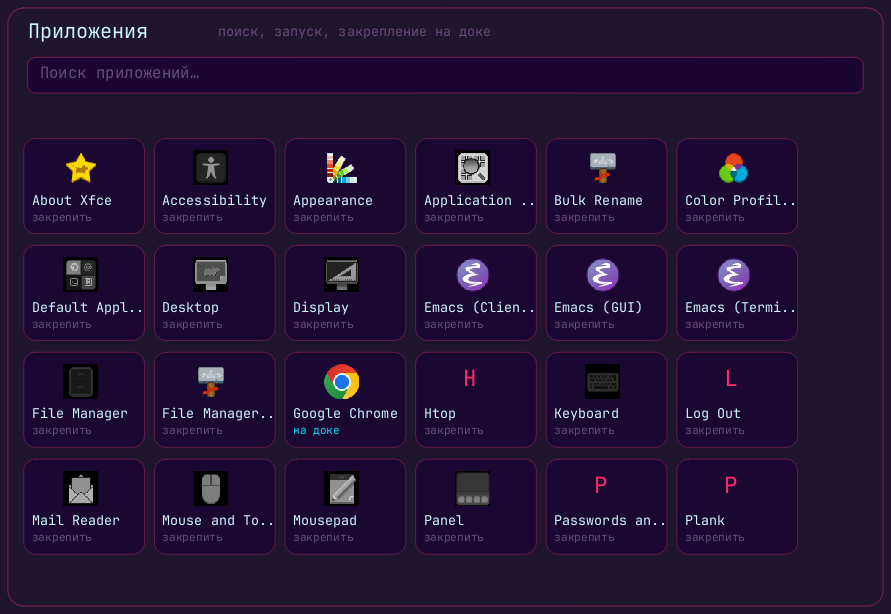
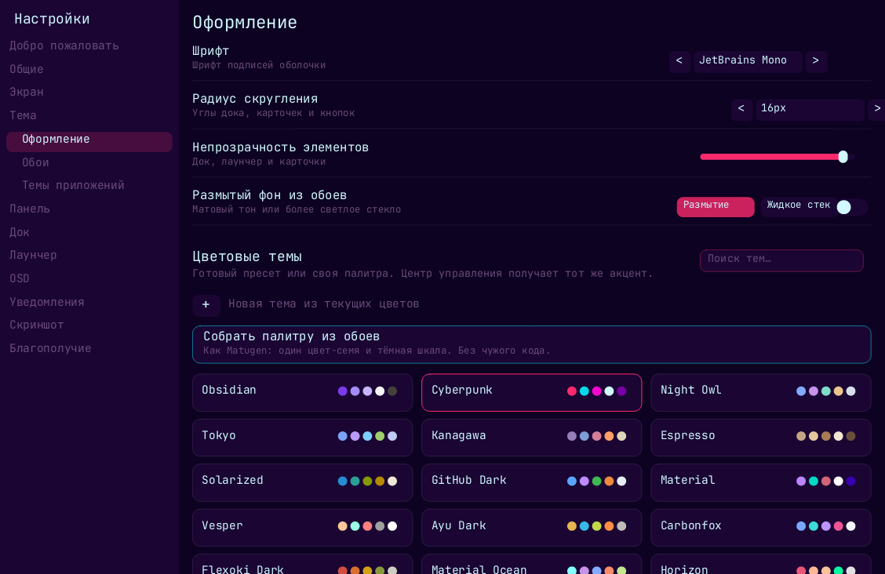
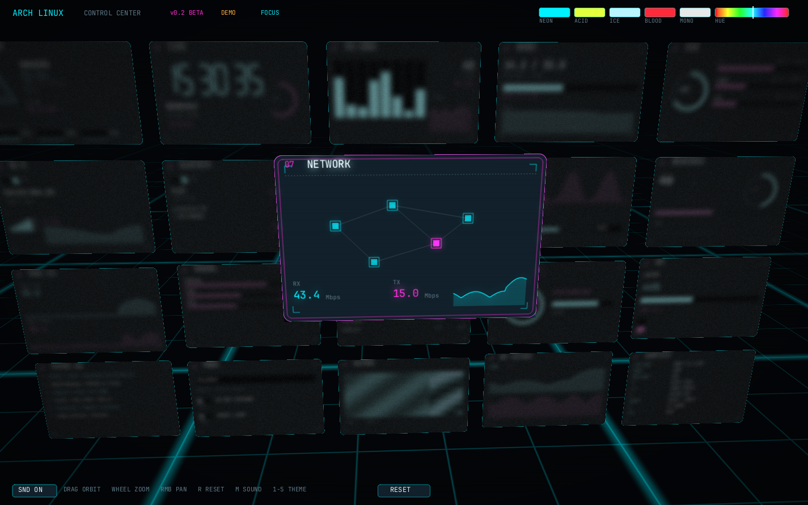

# Arch Control Center

## ⬇️ Скачать и запустить

> [!TIP]
> Один блок ставит зависимости, клонирует репозиторий, собирает релиз и запускает демо.
> Пока [пул-реквест](https://github.com/levks787-star/cyber_Ui_Arch/pull/1) не влит в `main`, клонируется ветка `cursor/arch-control-center-dbfc`. После слияния уберите `-b cursor/arch-control-center-dbfc` и клонируйте `main`.

```bash
sudo pacman -S --needed base-devel git rustup pkgconf mesa libxkbcommon wayland alsa-lib
rustup default stable
git clone -b cursor/arch-control-center-dbfc https://github.com/levks787-star/cyber_Ui_Arch.git
# после слияния в main:
# git clone https://github.com/levks787-star/cyber_Ui_Arch.git
cd cyber_Ui_Arch
cargo build --release
./target/release/arch-control-center --demo
```

По умолчанию процесс сразу отцепляется от терминала: оболочка возвращается, окно терминала можно закрыть. Лог пишется в `~/.cache/arch-control-center/log.txt` (или `$XDG_CACHE_HOME/arch-control-center/log.txt`). Чтобы видеть вывод в этом же терминале: `--foreground` или `-f`.

Обновить уже склонированную копию и пересобрать:

```bash
git pull && cargo build --release
```

Бета оболочки для Arch и Hyprland: док слева, лаунчер приложений, настройки с темами и трёхмерный центр управления как одна из частей. Наведение на плитку центра выдвигает её и размывает остальные.






## Оболочка

`arch-control-center --shell` открывает док у левого края. Сверху кнопка обзора (лаунчер и рабочие столы), ниже закреплённые и запущенные приложения, внизу часы, вход в 3D-центр и настройки. Повторный `--shell` не создаёт второй док: `--launcher` и `--settings` просят уже запущенную оболочку открыть окно.

Лаунчер читает `.desktop` из каталогов XDG, показывает значки темы (PNG) и запускает `Exec`. «Закрепить» пишет идентификатор в конфиг. Рабочие столы и фокус окон идут через `hyprctl`, если Hyprland есть. Без него док всё равно запускает приложения.

Настройки повторяют привычную схему: слева разделы, справа страница. В «Оформлении» — шрифт, радиус в пикселях, непрозрачность, режимы «Размытие» и «Жидкое стекло», поиск тем, свои темы, сбор палитры из PNG-обоев и готовые пресеты (Obsidian, Cyberpunk, Night Owl, Tokyo, Kanagawa, Espresso, Solarized, GitHub Dark, Material, Vesper, Ayu, Carbonfox и другие). Всё пишется в `config.toml` и сразу видно на доке. Акцент уходит и в трёхмерный центр.

Текст чуть крупнее (около 13%) и садится на пиксельную сетку. Масштаб окна берётся из `scale_factor` монитора и поля `ui_scale`.

Установка, которая не переписывает чужой Hyprland, только добавляет одну строку `source`:

```bash
./install.sh
# снять, не трогая резервную копию:
./install.sh --uninstall
```

Сниппет: `hypr/arch-control-center.conf` (`exec-once`, Super+Space лаунчер, Super+Comma настройки, Super+D центр). Если `hyprland.conf` уже был, рядом появляется `hyprland.conf.bak.<дата>`. Из репозитория можно собрать пакет: `makepkg -f`. PKGBUILD ставит бинарник, `.desktop` и сниппет в `/usr/share`, конфиг пользователя он не правит.

Запуск вручную:

```bash
arch-control-center --shell
arch-control-center --center --demo
```

Бета трёхмерного центра управления: плотная панель из нумерованных плиток, которую можно свободно крутить в пространстве. Наведение выдвигает плитку к камере и размывает остальные. Неон, тонкая линейная графика, живые графики.





Стек: Rust, **wgpu** и **winit**. Настоящая 3D-сцена, орбитальная камера, постобработка (bloom) и размытие фона в шейдере плитки. Bevy 0.20 требует Rust 1.97 и очень долгую сборку; wgpu даёт тот же класс картинки (вращение по всем осям, зум, hover, blur) и собирается предсказуемо.

## Зависимости

Сборка на Arch:

```bash
sudo pacman -S --needed base-devel rustup pkgconf mesa libxkbcommon wayland alsa-lib
# libxkbcommon на Arch уже содержит libxkbcommon-x11.
# На Debian/Ubuntu отдельно: libxkbcommon-x11-0 libxkbcommon-dev
```

Для аппаратного Vulkan — загрузчик ICD и драйвер видеокарты. Приложение само **не** подменяет `VK_ICD_FILENAMES`, если переменная уже задана, и не переключает NVIDIA/AMD/Intel на lavapipe только из‑за отсутствия `/dev/dri/card0`.

```bash
sudo pacman -S vulkan-icd-loader
sudo pacman -S nvidia-utils    # NVIDIA, в том числе RTX 2060 и nvidia-open
sudo pacman -S vulkan-radeon   # AMD
sudo pacman -S vulkan-intel    # Intel
sudo pacman -S vulkan-swrast   # lavapipe, только VM / нет /dev/dri
```

Необязательные сервисы. Без них плитка показывает `UNAVAILABLE`, приложение не падает:

```bash
sudo pacman -S networkmanager bluez bluez-utils pipewire wireplumber \
  brightnessctl power-profiles-daemon
```

Громкость: `wpctl` (WirePlumber) или `pactl`. Яркость: sysfs `/sys/class/backlight` или `brightnessctl`. «Не беспокоить»: `dunstctl` или `makoctl`. Ночной свет: `gammastep` или `redshift`.

На Debian/Ubuntu для проверки в VM:

```bash
sudo apt install mesa-vulkan-drivers vulkan-tools libxkbcommon-dev pkg-config
```

Явный выбор бэкенда, если автоопределение ошиблось:

```bash
./target/release/arch-control-center --backend vulkan --demo
./target/release/arch-control-center --backend gl --demo
./target/release/arch-control-center --software --demo
# то же через окружение: ACC_BACKEND=vulkan ACC_SOFTWARE=1 WGPU_BACKEND=gl
```

`--software` включает lavapipe только если есть файл `/usr/share/vulkan/icd.d/lvp_icd.json` и вы сами не задали `VK_ICD_FILENAMES`. На RTX оставьте переменную пустой: загрузчик сам берёт `nvidia_icd.json`.

## Сборка и запуск

```bash
cargo build --release
./target/release/arch-control-center --demo
./target/release/arch-control-center            # живые CPU/RAM/диски/сеть
./target/release/arch-control-center --demo --showcase
./target/release/arch-control-center --demo --shots /tmp/acc-shots
```

`--demo` не трогает систему: тумблеры меняют только симуляцию. `--showcase` включает демо, медленно вращает сцену, фокусирует плитку NETWORK и переключает тему. `--shots` сохраняет три PNG и выходит.

Нужен графический сеанс (X11 или Wayland).

Оверлей поверх рабочего стола (без рамки, на весь экран, фон полупрозрачный, чтобы композитор мог его размыть):

```bash
arch-control-center --overlay
# или в конфиге: overlay = true
```

Повторный запуск с `--overlay` (или с `overlay = true`) закрывает уже открытую панель. `Esc` тоже закрывает, с плавным затуханием. Wayland `app_id` и класс X11 окна — `arch-control-center`.

## Hyprland

Готовый фрагмент для `~/.config/hypr/hyprland.conf`. `SUPER+D` открывает панель и тем же нажатием закрывает её.

```
bind = SUPER, D, exec, arch-control-center --demo --overlay
# уберите --demo, когда нужны живые датчики:
# bind = SUPER, D, exec, arch-control-center --overlay

windowrulev2 = float, class:^(arch-control-center)$
windowrulev2 = fullscreen, class:^(arch-control-center)$
windowrulev2 = noborder, class:^(arch-control-center)$
windowrulev2 = noshadow, class:^(arch-control-center)$
windowrulev2 = noanim, class:^(arch-control-center)$
windowrulev2 = pin, class:^(arch-control-center)$
```

`exec` у Hyprland и так запускает программу без терминала. Если открыть бинарник из shell, он сам уходит в фон; для отладки добавьте `--foreground`. `noanim` отключает анимацию самого Hyprland: появление и уход рисует приложение. Окно — обычный toplevel (winit), не слой `zwlr_layer_shell`, поэтому `layerrule` на него не вешается. Размытие рабочего стола за полупрозрачным окном включает общий blur:

```
decoration {
    blur {
        enabled = true
        size = 8
        passes = 2
        xray = false
    }
}
```

Если панель когда-нибудь окажется в layer-shell с этим именем, правило такое:

```
layerrule = blur, ^(arch-control-center)$
```

## Запуск из меню

Файл `assets/arch-control-center.desktop` с `Terminal=false`. rofi, wofi и другие лаунчеры открывают панель без консоли. Класс окна тот же, `arch-control-center`, поэтому правило Hyprland выше продолжает работать.

```bash
install -Dm755 target/release/arch-control-center ~/.local/bin/arch-control-center
install -Dm644 assets/arch-control-center.desktop ~/.local/share/applications/arch-control-center.desktop
update-desktop-database ~/.local/share/applications || true
```

`~/.local/bin` должен быть в `PATH`. В `Exec` можно дописать `--demo` или `--overlay`. Живые датчики — строка `Exec=arch-control-center` как в файле.

## Управление

Камера как в Scene View Unity: рысканье вокруг вертикали мира, тангаж с ограничением, без накопления крена. Все движения сглаживаются критически затухающей пружиной и не зависят от частоты кадров. Крен по всем осям остаётся отдельным жестом.

| Ввод | Действие |
| --- | --- |
| Alt+ЛКМ, или ЛКМ по пустому месту | Орбита вокруг точки (рысканье и тангаж). ЛКМ по тумблеру или ползунку их нажимает, а не крутит камеру |
| Ctrl+ЛКМ | Крен вокруг оси взгляда |
| Перетаскивание СКМ | Панорама |
| Alt+ПКМ или Alt+колёсико | Наезд к точке орбиты |
| Колёсико | Зум к курсору |
| Удержание ПКМ | Полёт: WASD, Q/E вниз/вверх, Shift быстрее, мышь — взгляд |
| `F` | Вписать наведённую плитку или всю сетку |
| Наведение | Плитка выезжает вперёд; фон за ней размывается одним проходом |
| Клик по тумблеру / ползунку | Wi-Fi, Bluetooth, громкость, яркость, DND, ночной свет, профиль питания |
| `R` или кнопка RESET | Плавно вернуть камеру |
| `1`–`5` | Темы Neon, Acid, Ice, Blood, Mono |
| `6` | Свой акцент (ползунок HUE справа сверху) |
| `M` или кнопка SND | Звук интерфейса вкл/выкл |
| `F3` | Счётчик FPS |
| `Esc` | Выход. В оверлее — плавное закрытие |

Качество картинки: `--quality low`, `medium` или `high` (по умолчанию `high`). От него зависят размер размытия, число проходов, bloom и MSAA.

| | Размытие | Проходы | Bloom | MSAA |
| --- | --- | --- | --- | --- |
| low | 1/8 кадра | 2 | нет | 1 |
| medium | 1/4 | 3 | да | 1 |
| high | 1/2 | 4 | да | 4 |

Размытие — один уменьшенный проход (сэмпл окрестности, затем разделимый гаусс) на всю сцену за кадр, не ядро на каждую плитку. Содержимое плиток кэшируется в текстуры и перерисовывается, когда меняются данные: графики около 15 Гц, часы раз в секунду. Опрос sysinfo, D-Bus и внешние команды (`wpctl`, `journalctl`, `brightnessctl`) идут в фоновом потоке. Кадр показывается в режиме Mailbox, если он есть, иначе Fifo. В логе старта строка адаптера: имя, бэкенд, тип устройства. На RTX это должна быть NVIDIA, не llvmpipe и не запасной GL.

Углы плиток, кнопок, тумблеров, образцов тем, ползунка HUE и RESET слегка скруглены. У каждого из них тонкая обводка цвета акцента. Фон под наведённой плиткой — матовое стекло: мягкое размытие, лёгкое зерно и приглушение цвета.

Звуки интерфейса синтезируются в программе (это не записи меню PlayStation). Короткий стеклянный тик при наведении, лёгкий перезвон когда плитка выезжает, разные щелчки вкл/выкл, тихие тики ползунка, мерцание при смене темы, выдох при сбросе камеры и короткий аккорд на старте. Если аудиоустройства нет, звук просто молчит. Громкость и выключатель пишутся в конфиг:

```toml
sound = true
sound_volume = 0.55
```

Тема пишется в `~/.config/arch-control-center/config.toml` (или `$XDG_CONFIG_HOME/arch-control-center/config.toml`):

```toml
theme = "neon"
custom_hue = 186.0
sound = true
sound_volume = 0.55
overlay = false
```

Переключение темы интерполирует цвета. Ползунок HUE задаёт свой основной и дополнительный акцент.

## Что реально работает

- CPU по ядрам, загрузка, частота, RAM, mount-ы, disk I/O (`/proc/diskstats`), сеть (`/proc/net/dev`), топ процессов, uptime, loadavg — через `sysinfo` и procfs.
- Температуры, батарея, GPU busy (`/sys/class/drm/.../gpu_busy_percent`) — если узлы есть.
- Wi-Fi: NetworkManager по D-Bus (`zbus`), свойство `WirelessEnabled`, SSID и сила сигнала активной точки.
- Bluetooth: BlueZ, `Adapter1.Powered` и список устройств.
- Громкость и mute: `wpctl`, запасной путь `pactl`.
- Яркость: запись в sysfs backlight, иначе `brightnessctl`.
- Профиль питания: `power-profiles-daemon` по D-Bus.
- DND: `dunstctl` / `makoctl`. Ночной свет: `gammastep` / `redshift`.
- Журнал: `journalctl -n 7`, если команда отвечает.
- Если сервиса нет — подпись `UNAVAILABLE` и текст причины. `--demo` рисует полный набор и даёт кликать тумблеры локально.
- Звук интерфейса: свой синтез на `rodio`, не блокирует кадр. Нет устройства — тишина. `M` или кнопка `SND` и поля `sound` / `sound_volume` в конфиге.

## Если не находится GPU

В логе при старте печатаются узлы `/dev/dri`, какие ICD лежат в `/usr/share/vulkan/icd.d`, и каждый адаптер, который увидел wgpu. Сначала пробуется Vulkan (предпочтение дискретной карте, для RTX 2060 это NVIDIA), затем OpenGL. Прозрачное окно оверлея, из‑за которого EGL на Wayland пишет `No config found`, пробуется отдельно и при неудаче открывается снова уже без прозрачности.

NVIDIA (проприетарный драйвер и `nvidia-open`), Hyprland, Wayland:

```bash
sudo pacman -S nvidia-utils vulkan-icd-loader
# модуль ядра должен отдавать DRM KMS, иначе Wayland не получит устройство:
# nvidia_drm.modeset=1
ls /usr/share/vulkan/icd.d/nvidia_icd.json
vulkaninfo --summary
```

Не задавайте `VK_ICD_FILENAMES`, если хотите обычный драйвер NVIDIA. Приложение не перезаписывает эту переменную, когда она уже есть в окружении, и не подставляет lavapipe только потому, что нет файла `/dev/dri/card0` (часто есть `card1` или только `renderD128`).

AMD и Intel:

```bash
sudo pacman -S vulkan-icd-loader vulkan-radeon   # AMD
sudo pacman -S vulkan-icd-loader vulkan-intel    # Intel
vulkaninfo --summary
```

Виртуалка без `/dev/dri`:

```bash
sudo pacman -S vulkan-icd-loader vulkan-swrast
./target/release/arch-control-center --software --demo
```

Если прозрачный оверлей на Wayland всё же не стартует, окно откроется без прозрачности (рабочий стол за ним не будет виден, панель останется). Явный бэкенд: `--backend vulkan` или `--backend gl`.

## Известные ограничения

- Обратная сторона плиток зеркалит текст: грани не отсекаются, чтобы панель была видна при полном обороте.
- Волна на плитке AUDIO — визуализация уровня, не захват микрофона.
- На lavapipe (эта VM без NVIDIA) вертикальная синхронизация Fifo держит частоту около обновления экрана, а MSAA 4 в `--quality high` заметно тяжелее, чем на RTX 2060. Для слабого GPU есть `--quality low`.
- Bloom и матовое размытие считаются на GPU одним уменьшенным проходом на кадр.
- PKGBUILD и часть плиток с концепта (контейнеры, firewall, updates, scatter) — TODO.
- Ночной свет и DND зависят от установленных утилит; отдельного портала GNOME в этой бете нет.

## Шрифт

В бинарник вшит [JetBrains Mono](https://github.com/JetBrains/JetBrainsMono) (SIL Open Font License 1.1). См. `assets/fonts/NOTICE.txt`.
